<p align="center">
  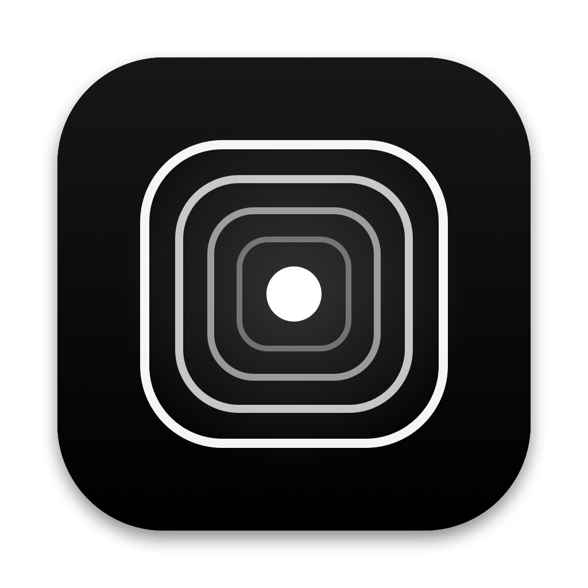
</p>

<h1 align="center">Omarchy için Houra</h1>

<p align="center">
  <b>Omarchy için sakin bir odak zamanlayıcısı.</b><br>
  Oturumu planla, süreyi göz önünde tut, mola gelince ekrandan uzaklaş.
</p>

<p align="center">
  <a href="README.md">English</a> · <b>Türkçe</b>
</p>

<p align="center">
  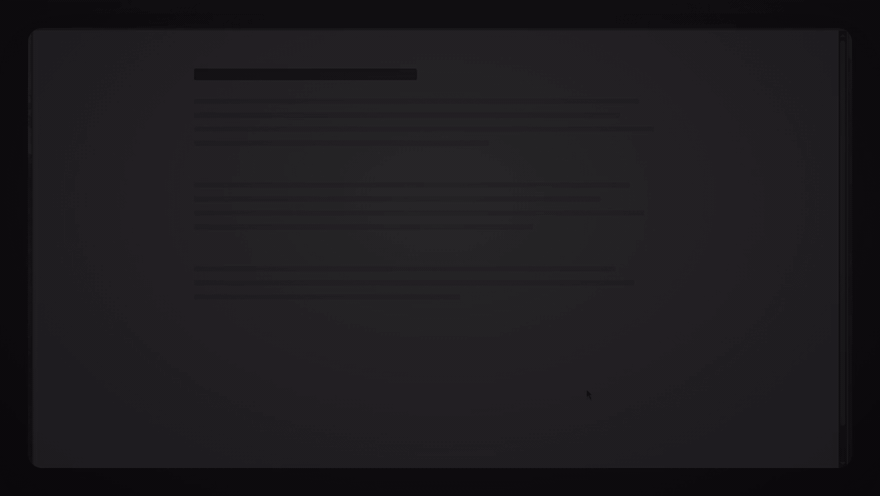
</p>

---

Bu, Houra'nın Omarchy sürümü; `omarchy-shell` ve Hyprland için yapıldı. macOS sürümü için Emirhan'ın (`@serbestonline`) [**Houra**](https://github.com/serbestonline/Houra) projesine bak; ikisi de aynı SQLite veri biçimini kullanır.

Houra üç fikir üzerine kurulu:

1. **Başlamadan karar ver.** Her oturum bir kategori, bir hedef ve istersen bugünün görevlerinden, haftalık notundan ya da Todoist'ten seçilmiş kısa bir yapılacaklar listesiyle başlar. Oturum başlayınca liste kilitlenir: yeni iş eklemek yerine planladığını bitirirsin.
2. **Süre görünsün ama önüne pencere çıkmasın.** Ekranda küçük bir etiket, şerit, kapsül, kart ya da halka durur. Üzerine tıklayınca oturumun tamamı yanında açılır, uzaklaşınca kapanır. Widget'ın dışındaki her yer tıklamayı geçirir, böylece döşemeli pencerelerin imleci hiç kaybetmez.
3. **Molayı gerçekten ver.** Süre dolunca bütün ekranları tam ekran bir mola kaplar. Erken dönmenin tek yolu, bilerek basılı tutulan *Acil durum* düğmesidir.

Her şey makinende, yerel bir SQLite dosyasında durur. Hesap ya da izleme yoktur; Todoist isteğe bağlıdır ve varsayılan olarak kapalıdır.

Arayüz Türkçe ve İngilizcedir, aktif Omarchy temanı izler.

## İçindekiler

- [Oturum](#oturum)
- [Ekrandaki görünümler](#ekrandaki-görünümler)
- [Mola ekranı](#mola-ekranı)
- [İstatistik](#i̇statistik)
- [Bugün, oturumlar ve kategoriler](#bugün-oturumlar-ve-kategoriler)
- [Todoist](#todoist)
- [Kurulum](#kurulum)
- [Klavye kısayolları](#klavye-kısayolları)
- [Veriler](#veriler)
- [Geliştirme ve katkı](#geliştirme-ve-katkı)

## Oturum

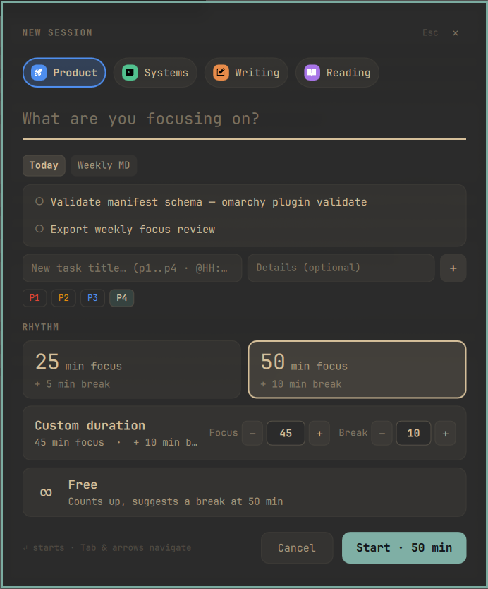

Oturumu çubuk menüsünden, panelden ya da bir tuş atamasıyla her yerden başlatırsın ([Klavye kısayolları](#klavye-kısayolları)).

- **Kategori:** her kategorinin bir rengi ve istersen bir emojisi ya da 100 hazır ikondan biri vardır.
- **Hedef:** *Neye odaklanıyorsun?* sorusuna birkaç kelimeyle cevap verirsin.
- **Görevler:** bugünün listesinden seçersin ya da başlık, isteğe bağlı açıklama, `P1–P4` önceliği ve saatle yenisini yazarsın (`p1`, `@14:30` satır içinde çalışır). Yeni görevler bugünün listesine de eklenir.
- **Haftanın listesi:** haftanı bir Markdown dosyasında, örneğin Obsidian'daki haftalık notunda planlıyorsan Houra oradaki açık görevleri okur, onlardan da seçebilirsin. Yolu *Ayarlar › Haftalık görevler*'de verirsin; yıl, hafta ve ay (`{YYYY}`, `{WW}`, `{MM}`) ile herhangi bir klasör için `*` içerebilir, böylece hafta dönünce kendiliğinden yeni dosyaya geçer. Dosya yalnız okunur, hiçbir şey yazılmaz.
- **Ritim:** **25 + 5**, **50 + 10**, **özel** bir süre (1–240 dk odak, 1–90 dk mola) ya da **serbest**: sayaç ileri akar, her 50 dakikada ekran yanıp söner ve widget mola isteyip istemediğini sorar. Hayır demek serbest.

Oturum sırasında her görevin üç durumu vardır, tıklayarak değişir:

| | |
|---|---|
| 🤓 | yapılacak |
| 🙂‍↔️ | şu an yapılıyor (aynı anda tek görev) |
| 🥳 | tamamlandı |

Her oturumun bir de serbest **Notlar** alanı vardır. Görevler ve notlar oturumla birlikte saklanır, sonra *Oturumlar* sayfasında görünür.

<br clear="right">

## Ekrandaki görünümler

<p align="center">
  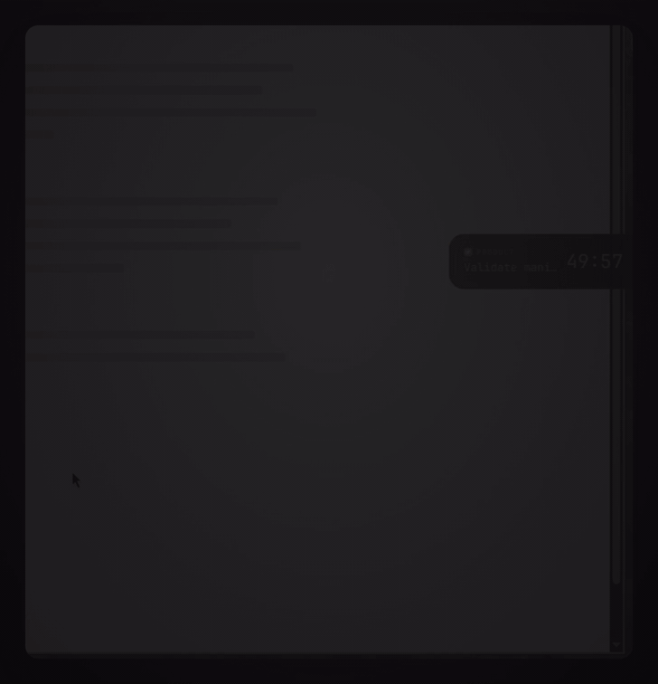
</p>

Oturum sürerken Houra kalan süreyi ve üzerinde çalıştığın görevi beş görünümden birinde gösterir. *Ekranda göster* ayarından ya da çubuk menüsünden seçersin:

| Görünüm | Nasıl görünür |
|---|---|
| **Etiket** | Ekran kenarına yapışık: kategori, o anki görev ve süre; altında ince ilerleme çizgisi. |
| **İnce şerit** | Kenar boyunca aşağıdan dolan ince bir çizgi; süre dolumun tepesinde. |
| **Kapsül** | Görev, süre ve duraklat düğmesi olan yüzen bir hap. |
| **Kart** | Büyük ilerleme halkalı yüzen bir kart. |
| **Halka** | İçinde süre yazan küçük bir halka. |

Herhangi bir görünüme **tıklayınca** ayrıntı paneli yanında açılır: büyük geri sayım, *Duraklat* ve *Oturumu bitir*, *Molasız kapat* ya da *İptal et*, görev listesi, notların ve bugünün akışı. Fareyi çekince kapanır; not yazarken açık kalır. İnce şeritte panel, kenar boyunca bir çekmece gibi kayarak açılır.

Görünümü **basılı tutup sürükleyerek** taşırsın. Etiket ve şerit en yakın kenara (sol ya da sağ) yapışır. Kapsül, kart ve halka bıraktığın yerde kalır. Başka bir monitörle paylaştığın kenarın ötesine sürüklersen görünüm o ekrana geçer. Konumlar hatırlanır; monitör ya da çalışma alanı değiştirince görünüm yerinden oynamaz.

<p align="center">
  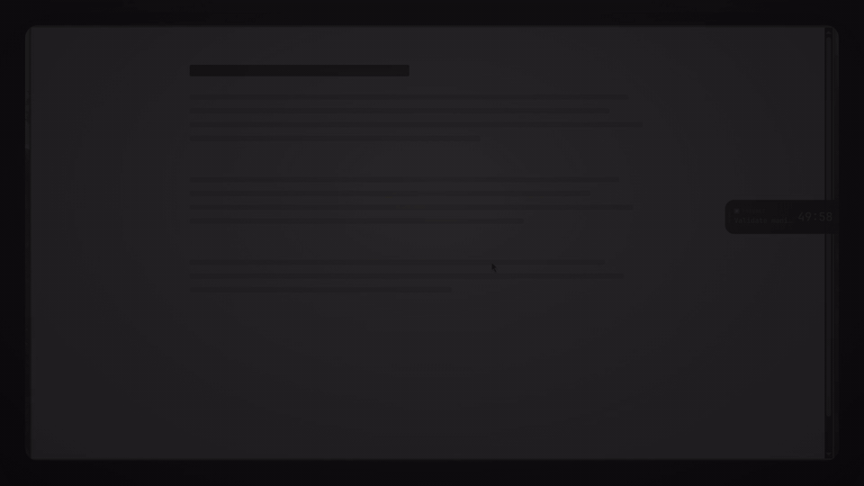
</p>

## Mola ekranı

<p align="center">
  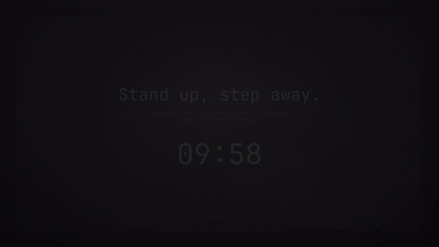
</p>

Odak süresi dolunca ya da *Oturumu bitir*'e basınca bütün ekranları yavaşça akan siyah-beyaz bir sahne ve mola geri sayımı kaplar. Tuş vuruşları bilerek yutulur.

Bir şey gerçekten bekleyemiyorsa **_Acil durum_ düğmesini 1,5 saniye basılı tut**. Mola çubukta sürer, erken dönüş kaydedilir, çubuk menüsünden molaya geri dönebilirsin (*Molaya geri dön*). Mola bitince Houra bir sonraki oturumu sorar.

## İstatistik

<p align="center">
  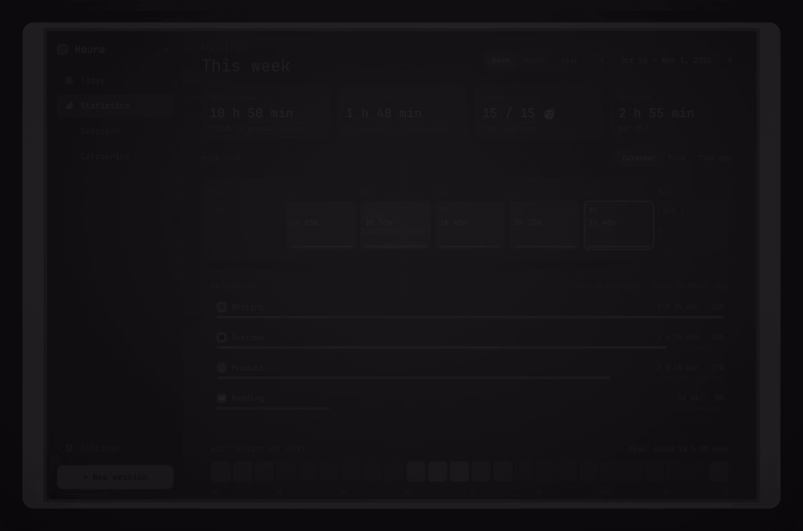
</p>

- **Dönem:** hafta, ay, yıl ya da takvimden seçilen herhangi bir aralık. ‹ › ile dönemler arasında gezinirsin.
- **Özet:** önceki döneme göre değişimiyle toplam odak, günlük ortalama, tamamlanan görevler ve en iyi gün.
- **Üç grafik:**
  - **Takvim:** her gün bir kutu; ince bir çizgi kategori dağılımını gösterir. Uzun aralıklarda yıllık ızgaraya dönüşür.
  - **Akış:** kategoriler zaman içinde üst üste yumuşak katmanlar halinde.
  - **Zaman haritası:** her gün bir satır, oturumlar gerçekten çalıştığın saatlerde.
- **Kategoriler:** üzerine gelince öne çıkar, tıklayınca bütün sayfa ona göre süzülür.
- **En verimli saatler:** gerçekte hangi saatlerde odaklandığını gösteren 24 saatlik şerit.
- **Gün ayrıntısı:** bir güne tıklayınca kategori dağılımı, oturumlar, ritimler ve görevler.

## Bugün, oturumlar ve kategoriler

<p align="center">
  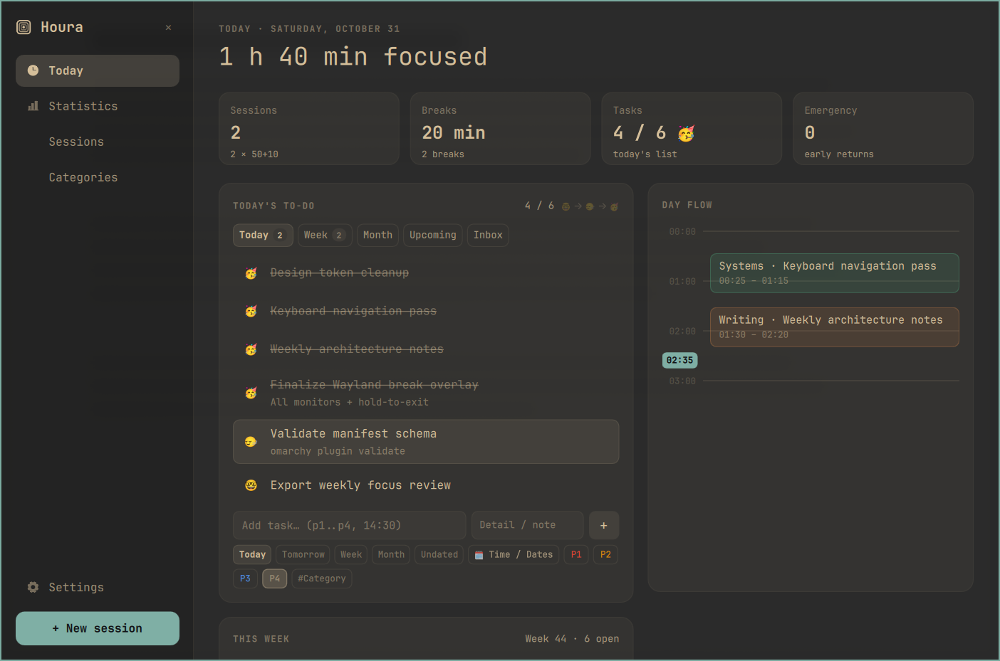
  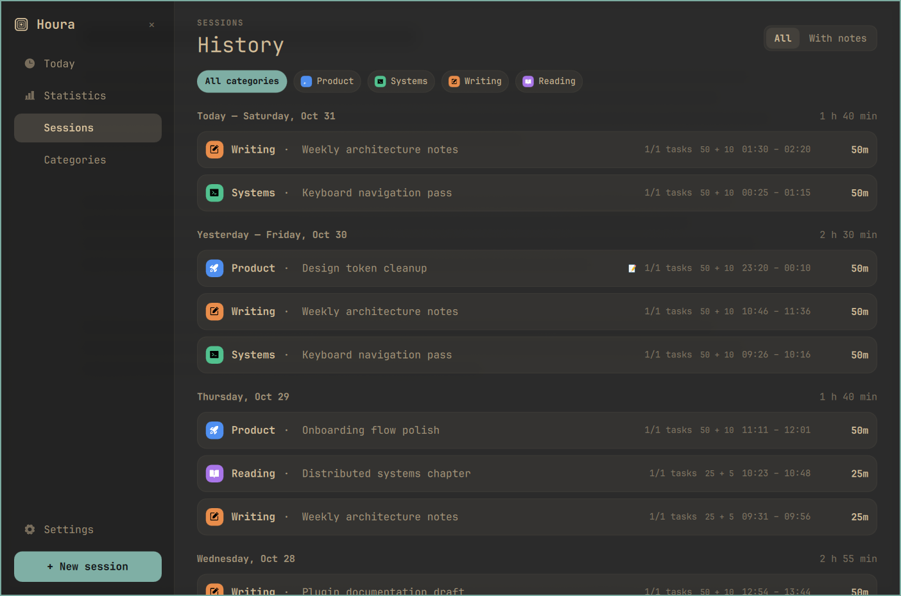
</p>

- **Bugün:** bugünün odağı, molaları, görevleri ve acil durumları; *Bugün*, *Hafta*, *Ay*, *Yaklaşan* ve *Gelen Kutusu* sekmeleri, öncelikler, saatler ve tekrarlayan görevler (her gün, hafta içi, haftalık, aylık) olan bir yapılacaklar planlayıcısı; oturumların dikey çizelgesi; haftalık görevler açıksa haftalık notundaki açık görevleri gösteren *Bu hafta* kartı. Bir göreve tıklayınca o görevle oturum açılır.
- **Oturumlar:** gün gün geçmiş; kategoriye ya da *Notlular*'a göre süzülür. Oturuma tıklayınca görevleri ve notları açılır; yanlışlıkla başlattığın oturumu silebilirsin.

<p align="center">
  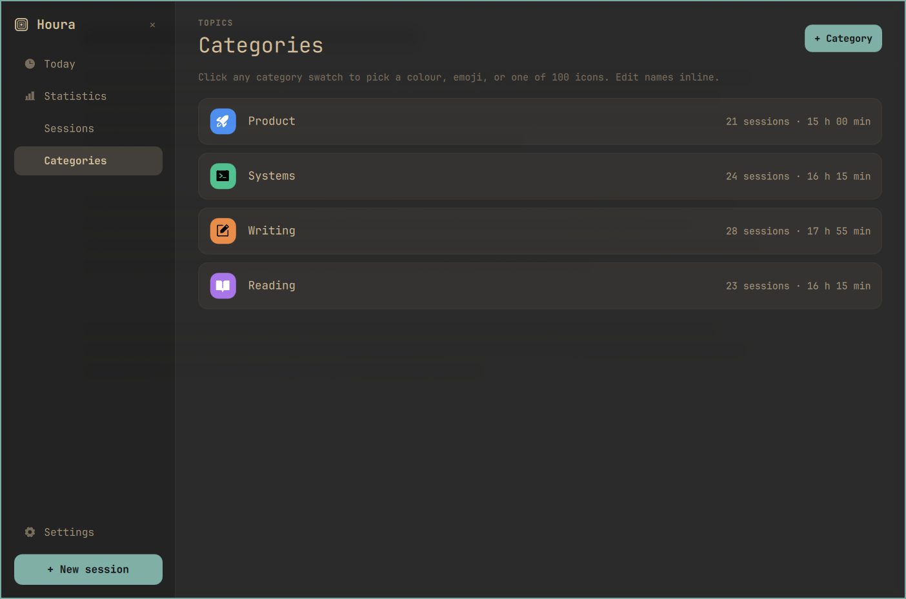
  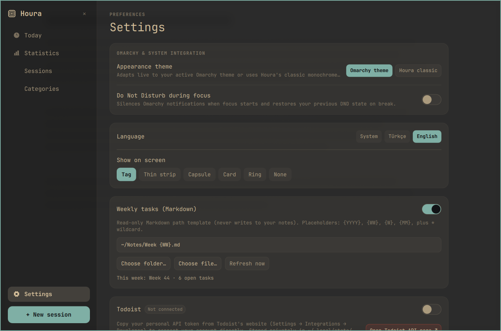
</p>

- **Kategoriler:** adı yerinde değiştirirsin. Kareye tıklayınca renk (ya da istediğin özel renk), emoji ya da Türkçe ve İngilizce aranabilen 100 [Phosphor](https://phosphoricons.com) ikonundan birini seçersin.
- **Ayarlar:** görünüm (Omarchy temanı ya da *Houra klasik*), odak sırasında Rahatsız Etme, dil, ekrandaki görünüm, haftalık görevler, Todoist ve veriler.

### Çubuk widget'ı

Çubuk simgesi, uygulama simgesindeki gibi bir noktanın çevresinde iç içe yuvarlak karelerdir. Oturum sırasında yalnız dış kare kalır ve süre ilerledikçe kendini çizer; yanında kalan süre yazar. Molada mola geri sayımını gösterir. Menüden oturum başlatabilir, son oturumlardan birini tekrarlayabilir, duraklatıp bitirebilir, ekrandaki görünümü değiştirip paneli açabilirsin.

## Todoist

<p align="center">
  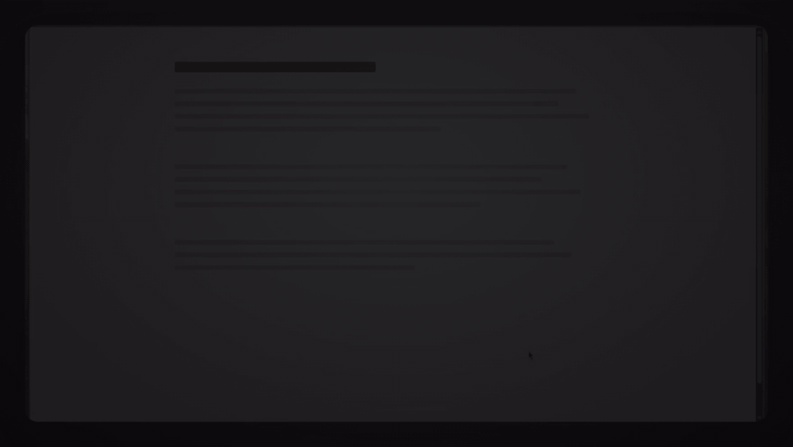
</p>

İsteğe bağlıdır, varsayılan olarak kapalıdır. Todoist'in web sitesinden (*Settings › Integrations › Developer*) kişisel bir API anahtarı alıp *Ayarlar › Todoist*'e yapıştır. Houra o zaman Todoist görevlerini kendi görevlerinin yanında listeler, yeni oturumda onlardan seçmene izin verir; öncelik, bitiş tarihi, saat ve tekrarla Todoist görevi oluşturup düzenleyebilir. Oturumu bitirmek bir Todoist görevini kendiliğinden kapatmaz; görev bitince sen açıkça tamamlarsın. Anahtar yalnız `~/.local/state/houra/todoist_token` dosyasında, `0600` izinleriyle saklanır. Bkz. [SECURITY.md](SECURITY.md).

## Kurulum

```bash
omarchy plugin add https://github.com/fatihaydost/omarchy-houra --enable
```

İstediğin zaman kaldırabilirsin:

```bash
omarchy plugin remove io.github.fatihaydost.houra
```

**Omarchy 4.x** gerekir. Yalnız Omarchy'nin zaten getirdiklerini kullanır (`omarchy-shell` / Quickshell, `python3` standart kütüphanesi, `pw-play`, `xdg-open`); üçüncü taraf bağımlılık yoktur.

İsteğe bağlı: `zenity` (`pacman` paketi) yerel klasör/dosya seçicilerini ve CSV kaydetme penceresini açar. Olmadan haftalık yolu elle yazarsın; CSV dışa aktarımı `~/Downloads` altına kaydedilir.

## Klavye kısayolları

Houra kendi başına hiçbir genel tuş almaz. İstediklerini `~/.config/hypr/bindings.lua` dosyasına ekle:

```lua
o.bind("SUPER + ALT + N", "Houra new session", "omarchy-shell houra newSession")
o.bind("SUPER + ALT + H", "Houra panel", "omarchy-shell houra panel")
```

| Tuş | İşlev |
|---|---|
| `Tab` / `Shift + Tab` | Kenar çubuğu ile sayfa denetimleri arasında geçiş |
| `↑` `↓` `←` `→` | Listelerde, sekmelerde, süzgeçlerde, ritimlerde ve ikon ızgarasında gezinme |
| `Ctrl + Tab` | Sonraki sekme |
| `Enter` / `Space` | Seç; yeni oturum penceresinde `Enter` oturumu başlatır |
| `Delete` | Seçili öğeyi sil |
| `Esc` | Metin alanından çık, çekmeceyi kapat, sonra pencereyi kapat |
| `SUPER + W`, `Ctrl + W`, `Ctrl + Q` | Houra penceresini kapat |

Her şey `omarchy-shell houra <komut>` ile betiklenebilir:

| Komut | İşlev |
|---|---|
| `newSession` | Yeni oturum penceresini aç ya da kapat |
| `panel`, `stats`, `tab <ad>` | Paneli aç (`today`, `stats`, `sessions`, `categories` ya da `settings` sekmesinde) |
| `close` | Açık her Houra penceresini kapat |
| `toggle` | Çubuk menüsünü aç |
| `pause`, `finish` | Duraklat / devam et, ya da bitirip molayı başlat |
| `closeSession`, `cancel` | Molasız kaydet, ya da oturumu at |
| `style <ad>` | Görünümü değiştir: `tag`, `strip`, `capsule`, `card`, `ring`, `none` |
| `syncTodoist`, `status` | Todoist'i şimdi eşitle, mevcut durumu JSON olarak yazdır |

## Veriler

Kategoriler, görevler, oturumlar ve notlar tek bir SQLite dosyasında durur:

```
~/.local/share/houra/houra.sqlite
```

Tercihler `~/.config/houra/settings.json` içinde durur. Todoist'i bağlamadıkça hiçbir şey makinenden dışarı çıkmaz. *Ayarlar*'dan veri klasörünü açabilir ya da bütün oturumları CSV olarak dışa aktarabilirsin. Oturum ortasında shell yeniden başlarsa Houra kaldığı yerden devam eder.

## Geliştirme ve katkı

Eklenti, `omarchy-shell` üzerinde düz QML'dir; arka uçta yalnız standart kütüphaneyi kullanan küçük bir Python betiği vardır:

| Yol | Ne yapar |
|---|---|
| `Service.qml` | Oturum motoru ve `omarchy-shell houra` IPC'si |
| `BarWidget.qml`, `components/BarPopout.qml` | Çubuk simgesi ve menüsü |
| `windows/OnScreenWidgetWindow.qml`, `components/DetailCard.qml` | Ekrandaki görünümler ve ayrıntı paneli |
| `windows/NewSessionWindow.qml`, `windows/RestOverlayWindow.qml` | Yeni oturum penceresi ve mola ekranı |
| `windows/MainPanelWindow.qml`, `pages/` | Panel: Bugün, İstatistik, Oturumlar, Kategoriler, Ayarlar |
| `backend/houra_cli.py` | SQLite depolama, haftalık Markdown, Todoist, CSV, zil sesi |

Geliştirirken klasörü `~/.config/omarchy/plugins/io.github.fatihaydost.houra` altına kopyala ve QML değişikliklerinden sonra `omarchy-restart-shell` çalıştır. Testleri `python3 -m unittest discover -s tests` ile çalıştırırsın.

README'deki görseller ve GIF'ler eklentinin kendisinden, örnek veriyle üretilir: `zsh media/record/make_media.sh` her senaryoyu boş bir çalışma alanında, kendi verine dokunmadan kaydeder; `media/` içindeki [Remotion](https://www.remotion.dev) kayıtları çerçeveleyip GIF'e çevirir. Todoist senaryosu gerçek Todoist API'sine değil, yerel bir taklit sunucuya (`media/record/mock_todoist.py`) bağlanır.

## Teşekkür

- macOS sürümü, özgün fikir ve tasarım: Emirhan'ın (`@serbestonline`) [**Houra**](https://github.com/serbestonline/Houra) projesi (MIT).
- Uygulama simgesi: [Houra](https://github.com/serbestonline/Houra)'nın macOS sürümünden (MIT).
- İkonlar: [Phosphor Icons](https://phosphoricons.com) (MIT).
- Omarchy sürümü: [Fatih Aydost (`@fatihaydost`)](https://github.com/fatihaydost).

## Lisans

MIT
